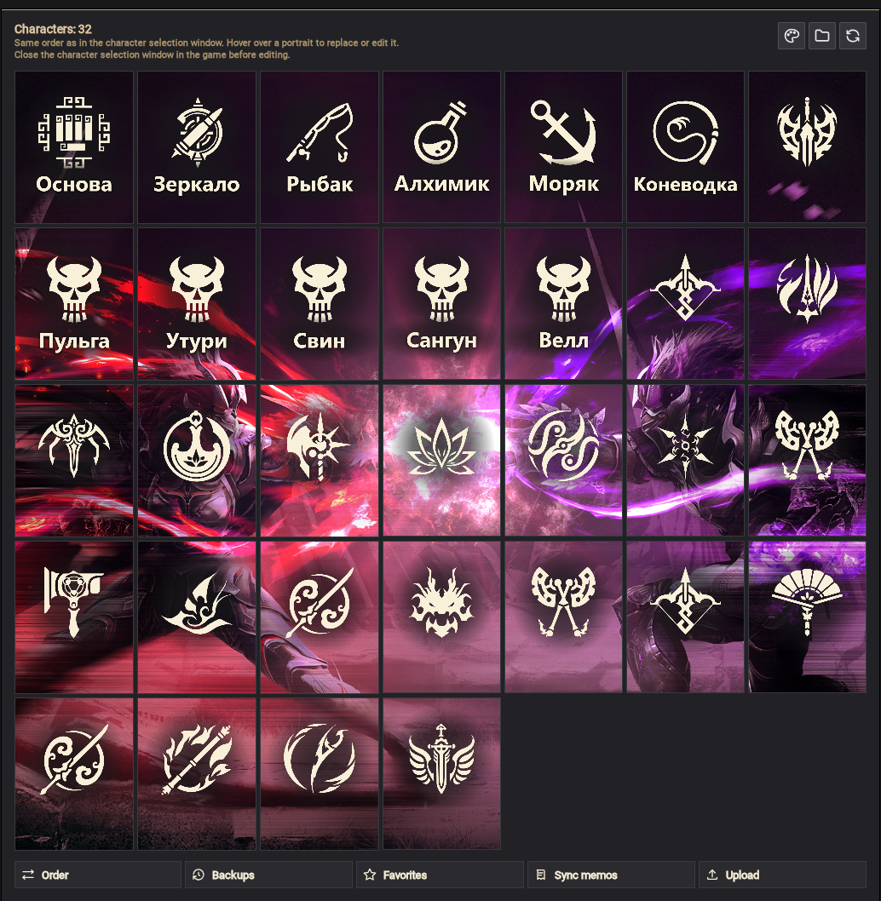
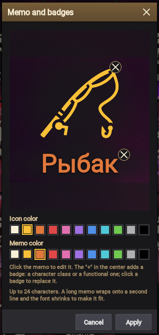
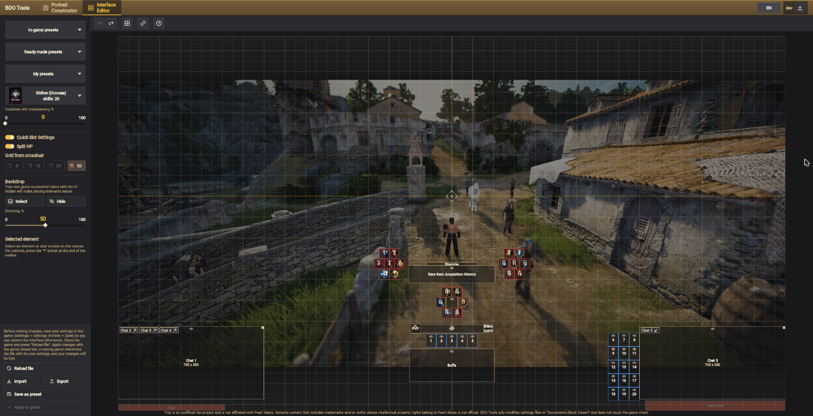
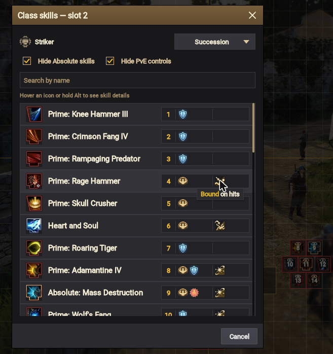
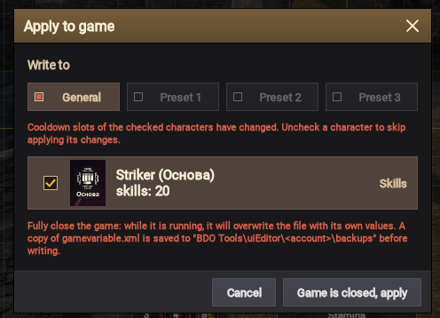
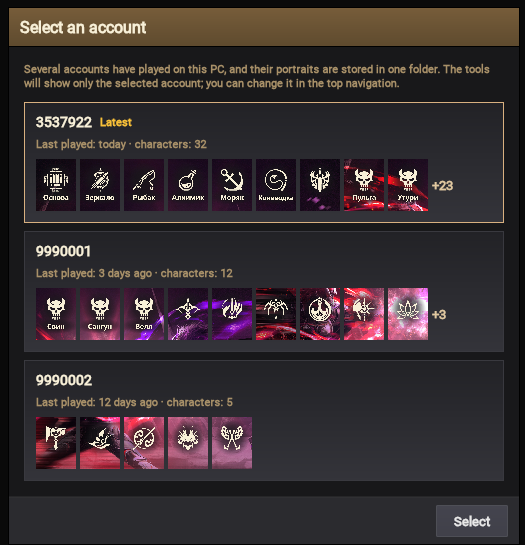

# BDO Tools

[Русский](README.md) · **English**

A set of tools for Black Desert Online players: your own character portraits and interface layout without
editing game files by hand. Runs in the browser and as a Windows app.

| | |
|---|---|
| 🌐 Website | https://layzenel.github.io/Black-Desert-Online-Tools/ |
| 💾 Windows app | [BDO-Tools.msi](https://github.com/Layzenel/Black-Desert-Online-Tools/releases/download/desktop-latest/BDO-Tools.msi) or [portable ZIP](https://github.com/Layzenel/Black-Desert-Online-Tools/releases/download/desktop-latest/BDO-Tools-portable.zip) |

> BDO Tools changes only the settings files in `Documents\Black Desert` and never touches the game client.
> It saves a copy of the previous files before every write.

> [!IMPORTANT]
> While the game is running, it overwrites its files on character switch, teleport and exit.
> So save your changes with the **game closed**.

**Contents**

- [Portrait Constructor](#portrait-constructor)
- [Interface Editor](#interface-editor)
- [Several accounts](#several-accounts)
- [Interface language](#interface-language)
- [Website or app](#website-or-app)
- [For developers](#for-developers)

---

## Portrait Constructor

Your own images instead of the portraits in the character selection window.



**Images**

- A grid of portraits in the same order as in the character selection window.
- Load an image from your computer (PNG, JPG, WEBP, BMP, GIF), from the clipboard or by link — for one portrait
  or for all at once.
- Frame editor: drag the image and zoom with the mouse wheel (10 to 400%).

**Memos and badges**

- A memo on the portrait — up to 24 characters.
- A character class badge or a functional badge (world boss, professions). The badge list has search at the top —
  just start typing; left click sets the badge, right click sets the badge and puts its name in the memo.
- Under the badge and memo there is one soft shade along their outline. Icon and memo color, shade color,
  strength and area — for one portrait in its "Memo and badges" window,
  for all at once with the "Memo, badge and shade colors of all portraits" icon next to the title.

  

- "Sync memos" — memos from the portraits go to the character memos in the "Account Character Overview" window.

**Order and sets**

- "Order" — swaps portraits two at a time until you turn the mode off with "Cancel" or Esc.
  Memos and badges stay in place.
- "Favorites" — saves all portraits as a set and brings it back in one click.
- Backups — a portrait can be restored to what it was before a replacement.

---

## Interface Editor

Lay out cooldown slots and other interface elements on a canvas instead of dragging them around in the game.



### Arranging elements

- Box selection, aligning and distributing elements (the gap slider moves the selection right away), snapping
  to the grid and to each other.
- The eye on an element hides or shows it; for a selected group — "Hide group" / "Show group" in the right-click
  menu.
- Fixed game elements — tips and the menu bar at the bottom, the health bar at the top left without "Split HP" —
  are filled with translucent red, as in the game's edit mode, so you don't put slots on them.
- Backdrop — your own game screenshot to see how the layout will look in the game, or another player's
  screenshot to place elements like they do. If the screenshot's aspect ratio differs from the game screen, the
  editor warns you.
- Undo and redo — Ctrl+Z and Ctrl+Y (or Ctrl+Shift+Z).

### Presets

- **"In-game presets"** — edit the general interface set or presets 1–3 from the game's "Interface Editing" window.
- **"Ready-made presets"** — the layout from the game file and ready-made cooldown slot layouts.
- **"My presets"** — your saved layouts: you can overwrite one with the current layout or delete it.

### Settings as in the game

- **"Quick Slot Settings"** — 20 separate hotbar slots or a single "Quick Slot" panel.
- **"Split HP"** — health, PVP and Black Spirit's Rage separately or a single fixed panel at the top left.
- **Chats** — the main window and separate chat windows on the canvas. They can be moved, resized by the top
  right corner and hidden with the eye. A tab of the main window can be moved to a separate window, and a
  separate window can be moved back with the buttons on the chat bars.

All three settings are carried over by import and export and written to the game together with the layout.

### Skills and labels in slots

Pick a character in the "Choose a character" list (with the portrait from `FaceTexture`) — the cooldown slots
show their skills and labels. The character's class is determined by their skills.

- **Add a skill** — double-click a cooldown slot or right-click → "Add skill". "Replace skill" and
  "Remove skill" are there too.
- **Skill picker**:
  - the title shows the number of the slot you are picking for;
  - top-rank skills of the class with the "Succession" or "Awakening" stance (Ascension classes have no stances)
    and search by name;
  - skills already in slots come first (the slot number is to the left of the icon), then the rest alphabetically;
  - on the right of each skill there is a bar: protection effects (Super Armor, Invincible, Forward Guard) |
    crowd controls. Hovering an icon shows its line from the skill description;
  - click a skill to put it in the slot;
  - "Hide Absolute skills" — for Succession, if the class has Prime skills;
  - "Hide PvE controls" (on) — keeps only the crowd controls that work in PvP.

  

- **One skill — one slot.** A skill picked from another slot moves together with its label.
  Shift+drag swaps the skills of two slots.
- **Skill hover tooltip** — the name, protection effects and PvP crowd controls; with Alt held — the description
  as in the game, in framed blocks (description, requirements and cooldown, command with the character's keys,
  effects).
- **Labels under slots** — up to the game's character limit. Right-click → "Label" adds, edits or deletes a
  skill's label. Below, under "Fill from skill description", is the first key combination from the skill's
  "Command" block (the green one, with the character's keys, e.g. "Shift + Q"): click it to put it in the label.
- **"Cooldown slot transparency"** — fades the frame of slots with skills so the icons look as in the game.

Portraits and captions from the "Portrait Constructor" are re-read every time you open the page.

> [!NOTE]
> The skill database and icons come from the open data of [bdolytics.com](https://bdolytics.com), so an internet
> connection is needed. Without it skills are shown as numbers only; the Windows program shows them from the copy
> saved on its previous run.

### Import and export

The "Import", "Export" and "Save as preset" buttons are at the bottom of the left menu.

- **Export** — share your layout with other players: as a file or with "Copy as text" — a line for chat (Discord).
- **Import** — apply another player's layout: from a file or by pasting the text.
- **Preview** before import and export — choose which elements go into the layout.
  - "Skills in slots" and "Labels under slots" carry over cooldown slot skills and their labels.
  - When importing skills, characters of their class or with empty slots get checked: the first one is selected in
    the editor, and "Apply to game" writes the skills to every checked character.
  - Only the chats that the player already has are changed.

### Applying to the game

"Apply to game" writes the layout to `gamevariable.xml` and saves a backup. The button shows how many changes are
not written yet.



- You can choose where to write: the general set or "Preset 1–3".
- If skills or labels in slots changed, the window shows which characters change and what exactly.
  Uncheck a character to leave their file as it is.
- The Windows program detects a running game and won't write until you close it.
- **"Undo apply"** — restores the game files to how they were before the last apply (while the page stays open);
  the layout stays in the editor.

---

## Several accounts



If several accounts have played on this PC, BDO Tools asks you to pick one the first time you open the game
folder. Each account shows when it was last played, how many characters it has and their first portraits.
To switch accounts, use the "Account" button in the top bar.

The tools work only with the selected account:

- "Portrait Constructor" shows only its characters: the game keeps the portraits of all accounts in one
  `FaceTexture` folder.
- "Interface Editor" reads and writes only its settings. To move a layout to another account, use "Export" and
  "Import".

<details>
<summary>Where BDO Tools keeps its files</summary>

Everything BDO Tools creates is in `Documents\Black Desert\BDO Tools` (next to the game's own settings, not in the
game installation folder), separately for each tool and each account:

- "Portrait Constructor" — `BDO Tools\portraitConstructor\<account>\`:
  - `FaceTexture_backup` — backups;
  - `Favorite FaceTexture` — favorites;
  - `Current portraits` — portraits without memos and badges, plus the memos and badges themselves;
  - `lobby_backup` — copies of the memo file.
- "Interface Editor" — `BDO Tools\uiEditor\<account>\`:
  - `presets` — "My presets";
  - `background` — the backdrop;
  - `backups` — copies of the game settings before writing.

Folders and files of previous versions (`FaceTexture_backup` and `Favorite FaceTexture` in the root of
`Black Desert`, `BDO Tools\portraits`, `BDO Tools\slots`, `BDO Tools\lobby_backup`) move to the folder of their
account the first time they are opened, or of the selected account if the account is unknown.

</details>

---

## Interface language

BDO Tools works in Russian and English. On first launch the language comes from the system or browser
(English if it is neither Russian nor English). Change it with the `RU` / `EN` button in the top bar;
the choice is remembered.

---

## Website or app

| | Website | Windows app |
|---|---|---|
| Installation | not needed | MSI or portable ZIP |
| Browser | Chrome, Edge, Opera, Yandex Browser | not needed |
| Access to the game folder | via browser permission | direct, finds `Documents\Black Desert` by itself |
| Updates | when the page is reloaded | the app offers to update itself |

The website needs the File System Access API, which only Chromium-based browsers have. In Firefox and Safari
the website offers to download the Windows app. There is also a link to it in the website's top bar.

---

## For developers

Kotlin Multiplatform and Compose Multiplatform: one codebase builds into the website (`wasmJs` and `js`) and the
Windows app (JVM). The website is published to GitHub Pages, and the installer to the `desktop-latest` release on
every push to `main`.

Website with live rebuild:

```bash
./gradlew :webApp:wasmJsBrowserDevelopmentRun --continuous
```

Windows app:

```bash
./gradlew :desktopApp:run
```

Check that both platforms build:

```bash
./gradlew :webApp:compileDevelopmentExecutableKotlinWasmJs :webApp:compileKotlinJs :desktopApp:compileKotlinDesktop
```

Module layout and project rules are in [CLAUDE.md](CLAUDE.md) (in Russian).

---

This is an unofficial fan project and is not affiliated with Pearl Abyss. Genuine content that includes trademarks
and/or works whose intellectual property rights belong to Pearl Abyss is not official.
