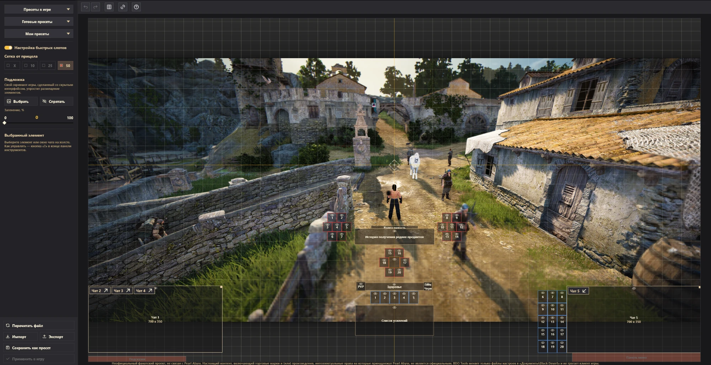

# BDO Tools

Набор инструментов для игроков Black Desert Online: портреты персонажей и раскладка интерфейса без ручной
правки файлов игры. Работает в браузере и как программа для Windows.

- **Сайт:** https://layzenel.github.io/Black-Desert-Online-Tools/
- **Программа для Windows:** [BDO-Tools.msi](https://github.com/Layzenel/Black-Desert-Online-Tools/releases/download/desktop-latest/BDO-Tools.msi)
  или [портативный ZIP](https://github.com/Layzenel/Black-Desert-Online-Tools/releases/download/desktop-latest/BDO-Tools-portable.zip)

BDO Tools меняет только файлы настроек в папке `Документы\Black Desert` и не трогает клиент игры.
Перед каждой записью он сохраняет копию прежних файлов.

## Что умеет

### Конструктор портретов


Свои картинки вместо портретов в окне выбора персонажа.

- Сетка портретов в том же порядке, что и в окне выбора персонажа.
- Загрузка картинки с компьютера (PNG, JPG, WEBP, BMP, GIF) или по ссылке — для одного портрета или сразу для всех.
- Редактор кадра: перетаскивание и масштаб колесом мыши.
- Заметка на портрете (до 24 символов) и значки: класс персонажа или функциональный (мировой босс, жизненные навыки).
- «Порядок» — менять портреты местами по два, пока режим не выключен кнопкой «Отменить» или Esc (заметки и значки остаются на прежних местах).
- «Избранное» — сохранить все портреты набором и вернуть его одним нажатием.
- Резервные копии: портрет можно восстановить до замены.
- «Синхр. с заметками» — заметки с портретов попадают в заметки персонажей в окне «Просмотр персонажей аккаунта».
- Несколько аккаунтов на одном ПК: тулзы показывают выбранный, переключатель — в верхней панели.

### Редактор интерфейса



Раскладка слотов перезарядки и других элементов интерфейса на холсте вместо перетаскивания их в игре.

- Готовые пресеты раскладки и свои пресеты.
- Выделение рамкой, выравнивание и распределение элементов, привязка к сетке и друг к другу.
- Подписи под слотами — заметки до лимита символов игры.
- Подложка — свой скриншот из игры, чтобы ставить слоты вокруг персонажа.
- Импорт и экспорт раскладки в `.json`: элементы встают от прицела и углов экрана, поэтому раскладка
  подходит к монитору с другим разрешением. Превью показывает, как она ляжет на чужой экран.
- Правка общего набора интерфейса или пресетов 1–3 из окна «Редактирование интерфейса».
- «Настройка быстрых слотов», как в игре: 20 отдельных слотов хотбара или одна панель «Быстрый слот».
  Переносится импортом и экспортом, записывается в игру вместе с раскладкой.
- Чаты: главное окно и отдельные окна чата на холсте. Их можно двигать,
  растягивать за правый верхний угол, скрывать глазиком. Вкладку главного окна можно вынести в отдельное окно, а отдельное окно внести обратно кнопками на плашках чатов.
  Чаты переносятся импортом и экспортом, но у игрока меняются только те чаты, что есть у него самого.
  «Применить в игру» записывает чаты вместе с раскладкой.
- Неподвижные элементы игры — подсказки и панель меню внизу экрана — показаны серыми рамками,
  чтобы не ставить на них слоты.
- «Применить в игру» — запись в `gamevariable.xml` с резервной копией.

Пока игра запущена, она перезаписывает свои файлы при смене персонажа, телепорте и выходе. Поэтому
заметки и раскладку записывайте при закрытой игре.

## Сайт или программа

| | Сайт | Программа для Windows |
|---|---|---|
| Установка | не нужна | MSI или портативный ZIP |
| Браузер | Chrome, Edge, Opera, Яндекс.Браузер | не нужен |
| Доступ к папке игры | через разрешение браузера | напрямую |
| Обновления | при обновлении страницы | программа сама предлагает обновиться |

Сайту нужен File System Access API, а он есть только в браузерах на Chromium. В Firefox и Safari сайт
предложит скачать программу для Windows. Ссылка на неё есть и в верхней панели сайта.

## Для разработчиков

Kotlin Multiplatform и Compose Multiplatform: один код собирается в сайт (`wasmJs` и `js`) и в программу
для Windows (JVM). Сайт выкладывается на GitHub Pages, а установщик — в релиз `desktop-latest` при каждом
пуше в `main`.

```bash
./gradlew :webApp:wasmJsBrowserDevelopmentRun --continuous
```

```bash
./gradlew :desktopApp:run
```

```bash
./gradlew :webApp:compileDevelopmentExecutableKotlinWasmJs :webApp:compileKotlinJs :desktopApp:compileKotlinDesktop
```

Устройство модулей и правила проекта — в [CLAUDE.md](CLAUDE.md).

---

Неофициальный фанатский проект, не связан с Pearl Abyss. Настоящий контент, включающий торговые марки
и (или) произведения, интеллектуальные права на которые принадлежат Pearl Abyss, не является официальным.
