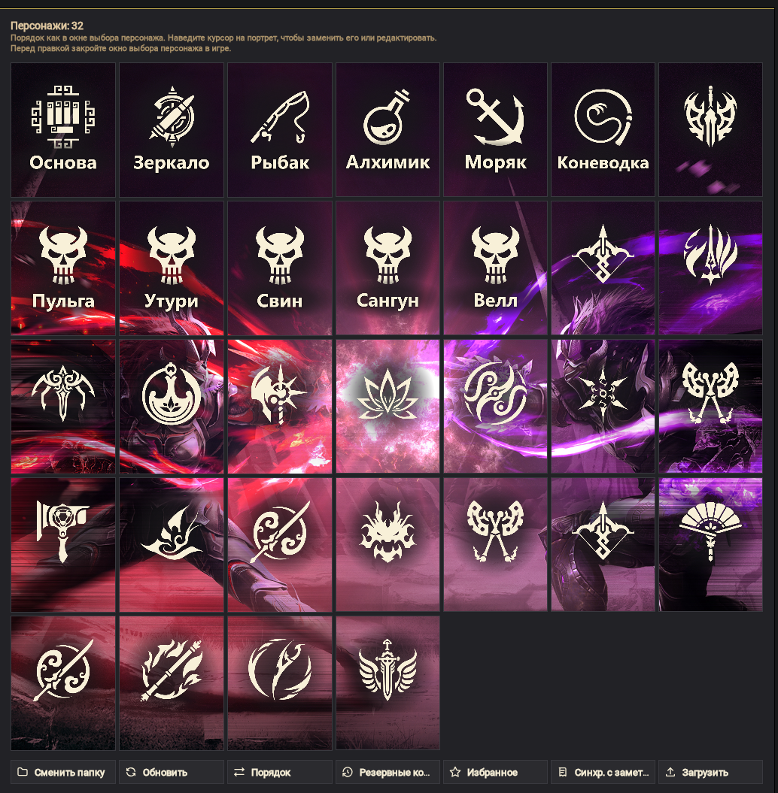
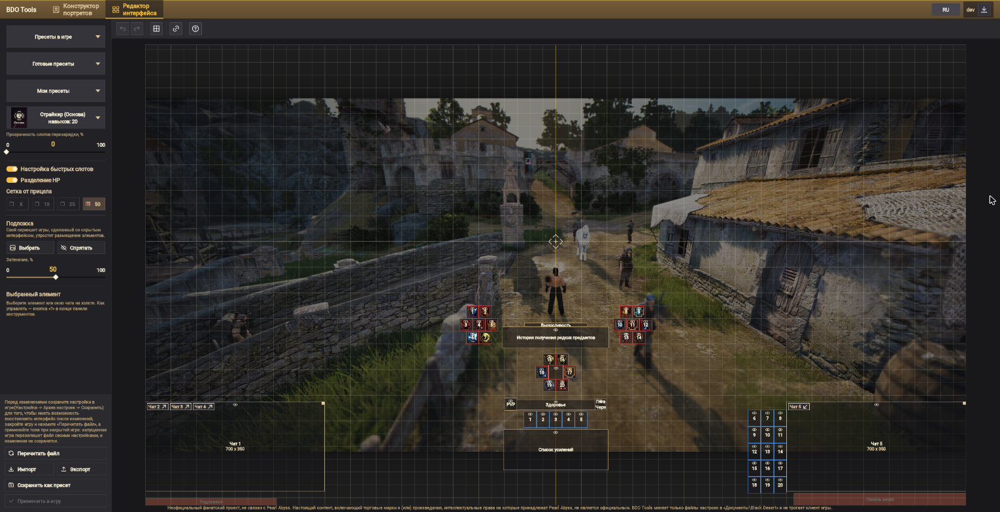
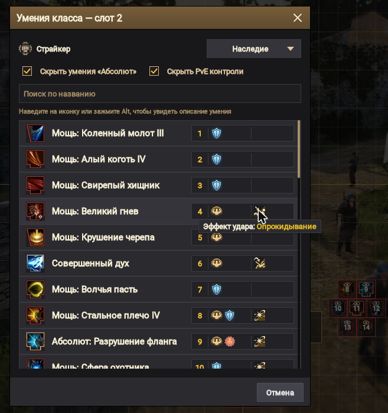
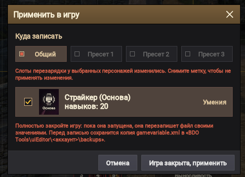

# BDO Tools

**Русский** · [English](README.en.md)

Набор инструментов для игроков Black Desert Online: свои портреты персонажей и раскладка интерфейса без ручной
правки файлов игры. Работает в браузере и как программа для Windows.

| | |
|---|---|
| 🌐 Сайт | https://layzenel.github.io/Black-Desert-Online-Tools/ |
| 💾 Программа для Windows | [BDO-Tools.msi](https://github.com/Layzenel/Black-Desert-Online-Tools/releases/download/desktop-latest/BDO-Tools.msi) или [портативный ZIP](https://github.com/Layzenel/Black-Desert-Online-Tools/releases/download/desktop-latest/BDO-Tools-portable.zip) |

> BDO Tools меняет только файлы настроек в папке `Документы\Black Desert` и не трогает клиент игры.
> Перед каждой записью он сохраняет копию прежних файлов.

> [!IMPORTANT]
> Пока игра запущена, она перезаписывает свои файлы при смене персонажа, телепорте и выходе.
> Поэтому записывайте изменения при **закрытой игре**.

**Содержание**

- [Конструктор портретов](#конструктор-портретов)
- [Редактор интерфейса](#редактор-интерфейса)
- [Несколько аккаунтов](#несколько-аккаунтов)
- [Язык интерфейса](#язык-интерфейса)
- [Сайт или программа](#сайт-или-программа)
- [Для разработчиков](#для-разработчиков)

---

## Конструктор портретов

Свои картинки вместо портретов в окне выбора персонажа.



**Картинки**

- Сетка портретов в том же порядке, что и в окне выбора персонажа.
- Загрузка картинки с компьютера (PNG, JPG, WEBP, BMP, GIF) или по ссылке — для одного портрета или сразу для всех.
- Редактор кадра: перетаскивание и масштаб колесом мыши.

**Заметки и значки**

- Заметка на портрете — до 24 символов.
- Значок класса персонажа или функциональный значок (мировой босс, профессии).
- Цвет заметки и значка — у одного портрета в его окне «Заметка и значки», у всех сразу — значком «Цвет заметок
  и значков всех портретов» у заголовка.
- «Заметки» — синхронизация: заметки с портретов попадают в заметки персонажей в окне
  «Просмотр персонажей аккаунта».

**Порядок и наборы**

- «Порядок» — меняет портреты местами по два, пока режим не выключен кнопкой «Отменить» или Esc.
  Заметки и значки остаются на прежних местах.
- «Избранное» — сохраняет все портреты набором и возвращает его одним нажатием.
- Резервные копии — портрет можно восстановить до замены.

---

## Редактор интерфейса

Раскладка слотов перезарядки и других элементов интерфейса на холсте вместо перетаскивания их в игре.



### Расстановка элементов

- Выделение рамкой, выравнивание и распределение элементов, привязка к сетке и друг к другу.
- Глазик на элементе скрывает или показывает его; у выбранной группы — «Скрыть группу» / «Показать группу»
  в меню правого клика.
- Неподвижные элементы игры — подсказки и панель меню внизу экрана, панель здоровья слева вверху без
  «Разделения HP» — залиты прозрачно-красным, как в режиме правки игры, чтобы не ставить на них слоты.
- Подложка — свой скриншот из игры, чтобы видеть, как раскладка будет выглядеть в игре, или скриншот другого
  игрока, чтобы расположить элементы как у него. Если соотношение сторон скриншота не как у экрана игры, редактор
  предупредит.
- Отменить и повторить — Ctrl+Z и Ctrl+Y (или Ctrl+Shift+Z).

### Пресеты

- **«Пресеты в игре»** — правка общего набора интерфейса или пресетов 1–3 из окна «Редактирование интерфейса».
- **«Готовые пресеты»** — раскладка из файла игры и готовые раскладки слотов перезарядки.
- **«Мои пресеты»** — свои сохранённые раскладки: их можно заменить текущей раскладкой или удалить.

### Настройки как в игре

- **«Настройка быстрых слотов»** — 20 отдельных слотов хотбара или одна панель «Быстрый слот».
- **«Разделение HP»** — здоровье, PVP и гнев Черного духа отдельно или одна неподвижная панель слева вверху.
- **Чаты** — главное окно и отдельные окна чата на холсте. Их можно двигать, растягивать за правый верхний угол
  и скрывать глазиком. Вкладку главного окна можно вынести в отдельное окно, а отдельное окно — внести обратно
  кнопками на плашках чатов.

Все три настройки переносятся импортом и экспортом и записываются в игру вместе с раскладкой.

### Умения и заметки в слотах

Выберите персонажа в списке «Выбрать персонажа» (с портретом из `FaceTexture`) — в слотах перезарядки появятся
его умения и их заметки. Класс персонажа определяется по его умениям.

- **Добавить умение** — двойной клик по слоту перезарядки или правый клик → «Добавить умение». Там же
  «Заменить умение» и «Убрать умение».
- **Окно выбора умений**:
  - в заголовке — номер слота, для которого выбирают;
  - умения последнего ранга класса со стойкой «Наследие» или «Пробуждение» (у классов «Освобождения» стоек нет)
    и поиск по названию;
  - сначала умения, которые уже стоят в слотах (номер слота — слева у иконки), потом остальные по алфавиту;
  - справа у каждого умения плашка: эффекты защиты (устойчивость, невредимость, защита от атак спереди) |
    контроли. При наведении на значок — его строка из описания умения;
  - клик по умению ставит его в слот;
  - «Скрыть умения «Абсолют»» — у наследия, если у класса есть «Мощь»;
  - «Скрыть PvE контроли» (включено) — оставляет только контроли, которые действуют в PvP.

  

- **Одно умение — один слот.** Умение, выбранное из другого слота, переезжает вместе с заметкой.
  Shift+перетаскивание меняет умения слотов местами.
- **Подсказка при наведении на умение** — название, эффекты защиты и PvP-контроли; с зажатым Alt — описание как
  в игре, блоками в рамке (описание, требования и перезарядка, команда с клавишами персонажа, эффекты).
- **Заметки под слотами** — до лимита символов игры. Правый клик → «Заметка» добавляет, редактирует или удаляет
  заметку умения. Ниже, под «Заполнить из описания умения», — первая связка клавиш из блока «Команда»
  (выделенная зелёным, с клавишами персонажа, например «Shift + Q»): клик ставит её в заметку.
- **«Прозрачность слотов перезарядки»** — приглушает рамку слотов с умениями, чтобы иконки выглядели как в игре.

Портреты и подписи из «Конструктора портретов» перечитываются при каждом открытии страницы.

> [!NOTE]
> Справочник умений и иконки берутся из открытых данных [bdolytics.com](https://bdolytics.com), поэтому нужен
> интернет. Без него умения видны только номерами; программа для Windows показывает их из копии, сохранённой
> при прошлом запуске.

### Импорт и экспорт

Кнопки «Импорт», «Экспорт» и «Сохранить как пресет» — внизу меню слева.

- **Экспорт** — поделиться своей раскладкой с другими игроками: файлом или «Копировать текстом» — строкой
  для чата (Discord).
- **Импорт** — применить раскладку другого игрока: из файла или вставив текст.
- **Превью** перед импортом и экспортом — выбрать, какие элементы войдут в раскладку.
  - «Умения в слотах» и «Заметки под слотами» переносят умения слотов перезарядки и их заметки.
  - При импорте умений отмечаются персонажи их класса или с пустыми слотами: первый выберется в редакторе,
    а «Применить в игру» запишет умения всем отмеченным.
  - Чаты у игрока меняются только те, что есть у него самого.

### Применение в игру

«Применить в игру» записывает раскладку в `gamevariable.xml` и сохраняет резервную копию. На кнопке — сколько
изменений ещё не записано.



- Можно выбрать, куда записать: общий набор или «Пресет 1–3».
- Если изменились умения или заметки в слотах, окно показывает, у каких персонажей и что именно изменится.
  С персонажа можно снять отметку — его файл останется как был.
- Программа для Windows видит запущенную игру и не пишет, пока её не закроют.
- **«Откатить применение»** — возвращает файлы игры к состоянию до последнего применения (пока страница
  не закрыта); раскладка в редакторе остаётся.

---

## Несколько аккаунтов


Если на ПК играли с нескольких аккаунтов, при первом открытии папки игры BDO Tools попросит выбрать аккаунт.
У каждого видно, когда в него играли последний раз, сколько на нём персонажей и их первые портреты.
Сменить аккаунт — кнопка «Аккаунт» в верхней панели.

Тулзы работают только с выбранным аккаунтом:

- «Конструктор портретов» показывает только его персонажей: игра хранит портреты всех аккаунтов в одной папке
  `FaceTexture`.
- «Редактор интерфейса» читает и записывает только его настройки. Перенести раскладку на другой аккаунт —
  «Экспорт» и «Импорт».

<details>
<summary>Где BDO Tools хранит свои файлы</summary>

Всё, что создаёт BDO Tools, лежит в папке `Документы\Black Desert\BDO Tools` (рядом с настройками игры, а не в
папке, куда установлена игра), у каждой тулзы и каждого аккаунта своё:

- «Конструктор портретов» — `BDO Tools\portraitConstructor\<аккаунт>\`:
  - `FaceTexture_backup` — резервные копии;
  - `Favorite FaceTexture` — избранное;
  - `Current portraits` — портреты без заметок и значков и сами заметки и значки;
  - `lobby_backup` — копии файла заметок.
- «Редактор интерфейса» — `BDO Tools\uiEditor\<аккаунт>\`:
  - `presets` — «Мои пресеты»;
  - `background` — подложка;
  - `backups` — копии настроек игры перед записью.

Папки и файлы прошлых версий (`FaceTexture_backup` и `Favorite FaceTexture` в корне `Black Desert`,
`BDO Tools\portraits`, `BDO Tools\slots`, `BDO Tools\lobby_backup`) при первом открытии переезжают в папку своего
аккаунта, а если аккаунт не известен — выбранного.

</details>

---

## Язык интерфейса

BDO Tools работает на русском и английском. При первом запуске язык берётся из системы или браузера
(если он не русский и не английский — английский). Сменить его — кнопка `RU` / `EN` в верхней панели;
выбор запоминается.

---

## Сайт или программа

| | Сайт | Программа для Windows |
|---|---|---|
| Установка | не нужна | MSI или портативный ZIP |
| Браузер | Chrome, Edge, Opera, Яндекс.Браузер | не нужен |
| Доступ к папке игры | через разрешение браузера | напрямую, `Документы\Black Desert` находит сама |
| Обновления | при обновлении страницы | программа сама предлагает обновиться |

Сайту нужен File System Access API, а он есть только в браузерах на Chromium. В Firefox и Safari сайт
предложит скачать программу для Windows. Ссылка на неё есть и в верхней панели сайта.

---

## Для разработчиков

Kotlin Multiplatform и Compose Multiplatform: один код собирается в сайт (`wasmJs` и `js`) и в программу
для Windows (JVM). Сайт выкладывается на GitHub Pages, а установщик — в релиз `desktop-latest` при каждом
пуше в `main`.

Сайт с пересборкой на лету:

```bash
./gradlew :webApp:wasmJsBrowserDevelopmentRun --continuous
```

Программа для Windows:

```bash
./gradlew :desktopApp:run
```

Проверка, что собираются обе платформы:

```bash
./gradlew :webApp:compileDevelopmentExecutableKotlinWasmJs :webApp:compileKotlinJs :desktopApp:compileKotlinDesktop
```

Устройство модулей и правила проекта — в [CLAUDE.md](CLAUDE.md).

---

Неофициальный фанатский проект, не связан с Pearl Abyss. Настоящий контент, включающий торговые марки
и (или) произведения, интеллектуальные права на которые принадлежат Pearl Abyss, не является официальным.
