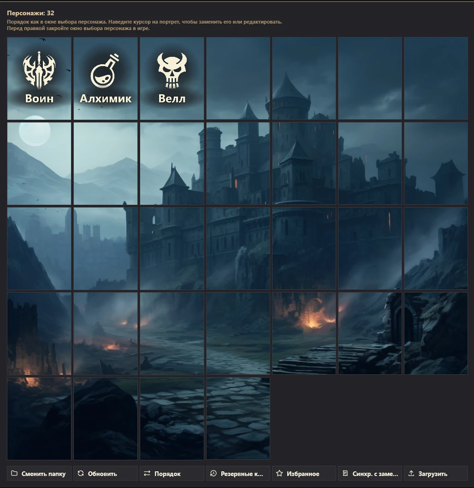
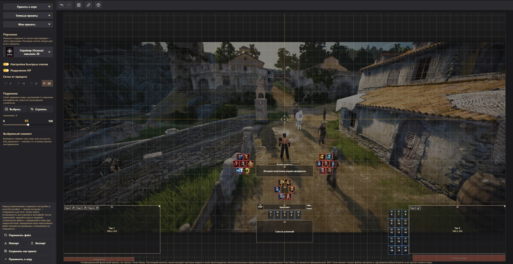
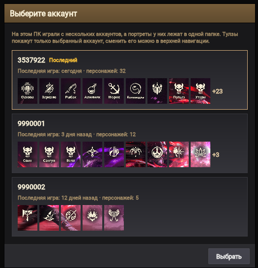

# BDO Tools

Набор инструментов для игроков Black Desert Online: портреты персонажей и раскладка интерфейса без ручной
правки файлов игры. Работает в браузере и как программа для Windows.

- **Сайт:** https://layzenel.github.io/Black-Desert-Online-Tools/
- **Программа для Windows:** [BDO-Tools.msi](https://github.com/Layzenel/Black-Desert-Online-Tools/releases/download/desktop-latest/BDO-Tools.msi)
  или [портативный ZIP](https://github.com/Layzenel/Black-Desert-Online-Tools/releases/download/desktop-latest/BDO-Tools-portable.zip)

BDO Tools меняет только файлы настроек в папке `Документы\Black Desert` и не трогает клиент игры.
Перед каждой записью он сохраняет копию прежних файлов.

## Что умеет

### Конструктор портретов



Свои картинки вместо портретов в окне выбора персонажа.

- Сетка портретов в том же порядке, что и в окне выбора персонажа.
- Загрузка картинки с компьютера (PNG, JPG, WEBP, BMP, GIF) или по ссылке — для одного портрета или сразу для всех.
- Редактор кадра: перетаскивание и масштаб колесом мыши.
- Заметка на портрете (до 24 символов) и значки: класс персонажа или функциональный (мировой босс, профессии).
- «Порядок» — менять портреты местами по два, пока режим не выключен кнопкой «Отменить» или Esc (заметки и значки остаются на прежних местах).
- «Избранное» — сохранить все портреты набором и вернуть его одним нажатием.
- Резервные копии: портрет можно восстановить до замены.
- «Синхронизация с заметками» — заметки с портретов попадают в заметки персонажей в окне «Просмотр персонажей аккаунта».

### Редактор интерфейса



Раскладка слотов перезарядки и других элементов интерфейса на холсте вместо перетаскивания их в игре.

- Готовые пресеты раскладки и свои пресеты: свой можно заменить текущей раскладкой или удалить.
- Выделение рамкой, выравнивание и распределение элементов, привязка к сетке и друг к другу.
- Подписи под слотами — заметки до лимита символов игры. У слота с умением это заметка умения из игры:
  её текст виден под слотом, а правый клик → «Заметка» добавляет, редактирует или удаляет её.
- Список «Выбрать персонажа» (с портретом из `FaceTexture`): в слотах перезарядки — умения выбранного персонажа и их заметки.
  Сначала персонаж не выбран. Класс персонажа определяется по его умениям. Двойной клик по слоту перезарядки или
  правый клик → «Добавить умение»: умения последнего ранга класса со стойкой «Наследие» или «Пробуждение» (у классов
  «Освобождения» стоек нет) и поиском по названию, у наследия — «Скрыть умения «Абсолют»» (если у класса есть
  «Мощь»); там же «Заменить умение» и «Убрать умение». Умение стоит только в одном слоте: выбранное из другого слота
  переезжает вместе с заметкой. Shift+перетаскивание меняет умения слотов местами. Наведение на умение — его
  название, с зажатым Alt — описание как в игре (требования, перезарядка, команда с клавишами персонажа, эффекты);
  в окне выбора — наведение на иконку или Alt. «Применить в игру» записывает умения и заметки
  в файл персонажа: окно применения показывает, у каких персонажей изменятся умения и/или заметки, и с кого-то из них
  можно снять отметку. У выбранного персонажа слайдер «Прозрачность слотов перезарядки» приглушает рамку слотов с умениями, чтобы иконки выглядели
  как в игре. Портреты и подписи из «Конструктора портретов» перечитываются при каждом открытии страницы. Справочник умений и иконки берутся из открытых данных
  [bdolytics.com](https://bdolytics.com), поэтому нужен интернет; без него умения видны только номерами.
- Подложка — свой скриншот из игры, чтобы видеть как настройки интерфейса будут выглядеть в игре. Или скриншот другого игрока, чтобы расположить элементы как у него.
- Экспорт раскладки - можно поделиться своей раскладкой с другими игроками.
- Импорт раскладки - можно применить раскладки других игрков.
- Превью импорт/экспорта - можно настроить какие элементы будут в раскладке перед тем как ими поделиться или применить.
  Переключатели «Умения в слотах» и «Заметки под слотами» переносят умения слотов перезарядки и их заметки;
  при импорте умений отмечают персонажей их класса или с пустыми слотами — первый выберется в редакторе,
  а «Применить в игру» запишет умения всем отмеченным.
- «Пресеты в игре» — правка общего набора интерфейса или пресетов 1–3 из окна «Редактирование интерфейса».
- «Настройка быстрых слотов», как в игре: 20 отдельных слотов хотбара или одна панель «Быстрый слот».
  Переносится импортом и экспортом, записывается в игру вместе с раскладкой.
- «Разделение HP», как в игре: здоровье, PVP и гнев Черного духа отдельно или одна неподвижная панель слева вверху.
  Переносится импортом и экспортом, записывается в игру вместе с раскладкой.
- Чаты: главное окно и отдельные окна чата на холсте. Их можно двигать,
  растягивать за правый верхний угол, скрывать глазиком. Вкладку главного окна можно вынести в отдельное окно, а отдельное окно внести обратно кнопками на плашках чатов.
  Чаты переносятся импортом и экспортом, но у игрока меняются только те чаты, что есть у него самого.
  «Применить в игру» записывает чаты вместе с раскладкой.
- Неподвижные элементы игры — подсказки и панель меню внизу экрана, панель здоровья слева вверху без «Разделения HP» — залиты прозрачно-красным, как в режиме правки игры,
  чтобы не ставить на них слоты.
- «Применить в игру» — запись в `gamevariable.xml` с резервной копией.

Пока игра запущена, она перезаписывает свои файлы при смене персонажа, телепорте и выходе. Поэтому
заметки и раскладку записывайте при закрытой игре.

### Несколько аккаунтов



Если на ПК играли с нескольких аккаунтов, при первом открытии папки игры BDO Tools попросит выбрать аккаунт.
У каждого видно, когда в него играли последний раз, сколько на нём персонажей и их первые портреты.
Тулзы работают только с выбранным аккаунтом.

- «Конструктор портретов» показывает только персонажей выбранного аккаунта: игра хранит портреты всех аккаунтов
  в одной папке `FaceTexture`.
- «Редактор интерфейса» читает и записывает настройки только выбранного аккаунта. Перенести раскладку на другой
  аккаунт — «Экспорт» и «Импорт».
- Всё, что создаёт BDO Tools, лежит в папке `Black Desert\BDO Tools`, у каждой тулзы и каждого аккаунта своё:
  - «Конструктор портретов» — `BDO Tools\portraitConstructor\<аккаунт>\`: `FaceTexture_backup` (резервные
    копии), `Favorite FaceTexture` (избранное), `Current portraits` (портреты без заметок и значков и сами заметки
    и значки), `lobby_backup` (копии файла заметок);
  - «Редактор интерфейса» — `BDO Tools\uiEditor\<аккаунт>\`: `presets` («Мои пресеты»), `background` (подложка),
    `backups` (копии настроек игры перед записью).

  Папки и файлы прошлых версий (`FaceTexture_backup` и `Favorite FaceTexture` в корне `Black Desert`,
  `BDO Tools\portraits`, `BDO Tools\slots`, `BDO Tools\lobby_backup`) при первом открытии переезжают туда,
  в папку своего аккаунта, а если аккаунт не известен — выбранного.
- Сменить аккаунт — кнопка «Аккаунт» в верхней панели: она открывает то же окно выбора.

### Язык интерфейса

BDO Tools работает на русском и английском. При первом запуске язык берётся из системы или браузера
(если он не русский и не английский — английский). Сменить его — кнопка `RU` / `EN` в верхней панели;
выбор запоминается.

## Сайт или программа

| | Сайт | Программа для Windows |
|---|---|---|
| Установка | не нужна | MSI или портативный ZIP |
| Браузер | Chrome, Edge, Opera, Яндекс.Браузер | не нужен |
| Доступ к папке игры | через разрешение браузера | напрямую |
| Обновления | при обновлении страницы | программа сама предлагает обновиться |

Сайту нужен File System Access API, а он есть только в браузерах на Chromium. В Firefox и Safari сайт
предложит скачать программу для Windows. Ссылка на неё есть и в верхней панели сайта.

## Для разработчиков

Kotlin Multiplatform и Compose Multiplatform: один код собирается в сайт (`wasmJs` и `js`) и в программу
для Windows (JVM). Сайт выкладывается на GitHub Pages, а установщик — в релиз `desktop-latest` при каждом
пуше в `main`.

```bash
./gradlew :webApp:wasmJsBrowserDevelopmentRun --continuous
```

```bash
./gradlew :desktopApp:run
```

```bash
./gradlew :webApp:compileDevelopmentExecutableKotlinWasmJs :webApp:compileKotlinJs :desktopApp:compileKotlinDesktop
```

Устройство модулей и правила проекта — в [CLAUDE.md](CLAUDE.md).

---

Неофициальный фанатский проект, не связан с Pearl Abyss. Настоящий контент, включающий торговые марки
и (или) произведения, интеллектуальные права на которые принадлежат Pearl Abyss, не является официальным.
