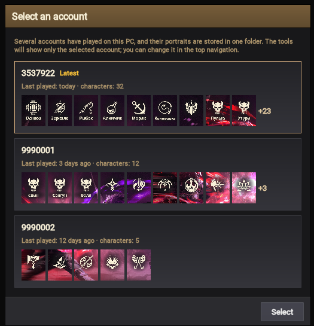

[← BDO Tools](../README.en.md) · [Русский](accounts.md) · **English**

# Several accounts

If several accounts have played on this PC, BDO Tools asks you to pick one the first time you open the game
folder. Each account shows when it was last played, how many characters it has and their first portraits.
To switch accounts, use the "Account" button in the top bar.

The tools work only with the selected account:

- "Portrait Constructor" shows only its characters: the game keeps the portraits of all accounts in one
  `FaceTexture` folder.
- "Interface Editor" reads and writes only its settings. To move a layout to another account, use "Export" and
  "Import".

Where BDO Tools keeps its files

Everything BDO Tools creates is in `Documents\Black Desert\BDO Tools` (next to the game's own settings, not in the
game installation folder), separately for each tool and each account:

- "Portrait Constructor" — `BDO Tools\portraitConstructor\<account>\`:
  - `FaceTexture_backup` — backups;
  - `Favorite FaceTexture` — favorites;
  - `Current portraits` — portraits without memos and badges, plus the memos and badges themselves;
  - `lobby_backup` — copies of the memo file.
- "Interface Editor" — `BDO Tools\uiEditor\<account>\`:
  - `presets` — "My presets";
  - `background` — the backdrop;
  - `backups` — copies of the game settings before writing.

Folders and files of previous versions (`FaceTexture_backup` and `Favorite FaceTexture` in the root of
`Black Desert`, `BDO Tools\portraits`, `BDO Tools\slots`, `BDO Tools\lobby_backup`) move to the folder of their
account the first time they are opened, or of the selected account if the account is unknown.

