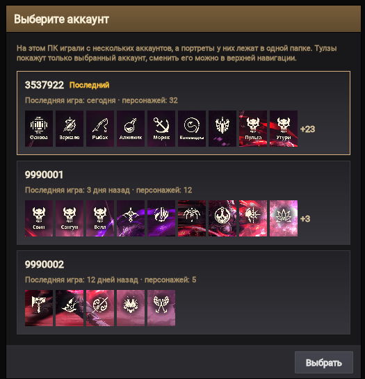

[← BDO Tools](../README.md) · **Русский** · [English](accounts.en.md)

# Несколько аккаунтов

Если на ПК играли с нескольких аккаунтов, при первом открытии папки игры BDO Tools попросит выбрать аккаунт.
У каждого видно, когда в него играли последний раз, сколько на нём персонажей и их первые портреты.
Сменить аккаунт — кнопка «Аккаунт» в верхней панели.

Тулзы работают только с выбранным аккаунтом:

- «Конструктор портретов» показывает только его персонажей: игра хранит портреты всех аккаунтов в одной папке
  `FaceTexture`.
- «Редактор интерфейса» читает и записывает только его настройки. Перенести раскладку на другой аккаунт —
  «Экспорт» и «Импорт».

Где BDO Tools хранит свои файлы

Всё, что создаёт BDO Tools, лежит в папке `Документы\Black Desert\BDO Tools` (рядом с настройками игры, а не в
папке, куда установлена игра), у каждой тулзы и каждого аккаунта своё:

- «Конструктор портретов» — `BDO Tools\portraitConstructor\<аккаунт>\`:
  - `FaceTexture_backup` — резервные копии;
  - `Favorite FaceTexture` — избранное;
  - `Current portraits` — портреты без заметок и значков и сами заметки и значки;
  - `lobby_backup` — копии файла заметок.
- «Редактор интерфейса» — `BDO Tools\uiEditor\<аккаунт>\`:
  - `presets` — «Мои пресеты»;
  - `background` — подложка;
  - `backups` — копии настроек игры перед записью.

Папки и файлы прошлых версий (`FaceTexture_backup` и `Favorite FaceTexture` в корне `Black Desert`,
`BDO Tools\portraits`, `BDO Tools\slots`, `BDO Tools\lobby_backup`) при первом открытии переезжают в папку своего
аккаунта, а если аккаунт не известен — выбранного.

