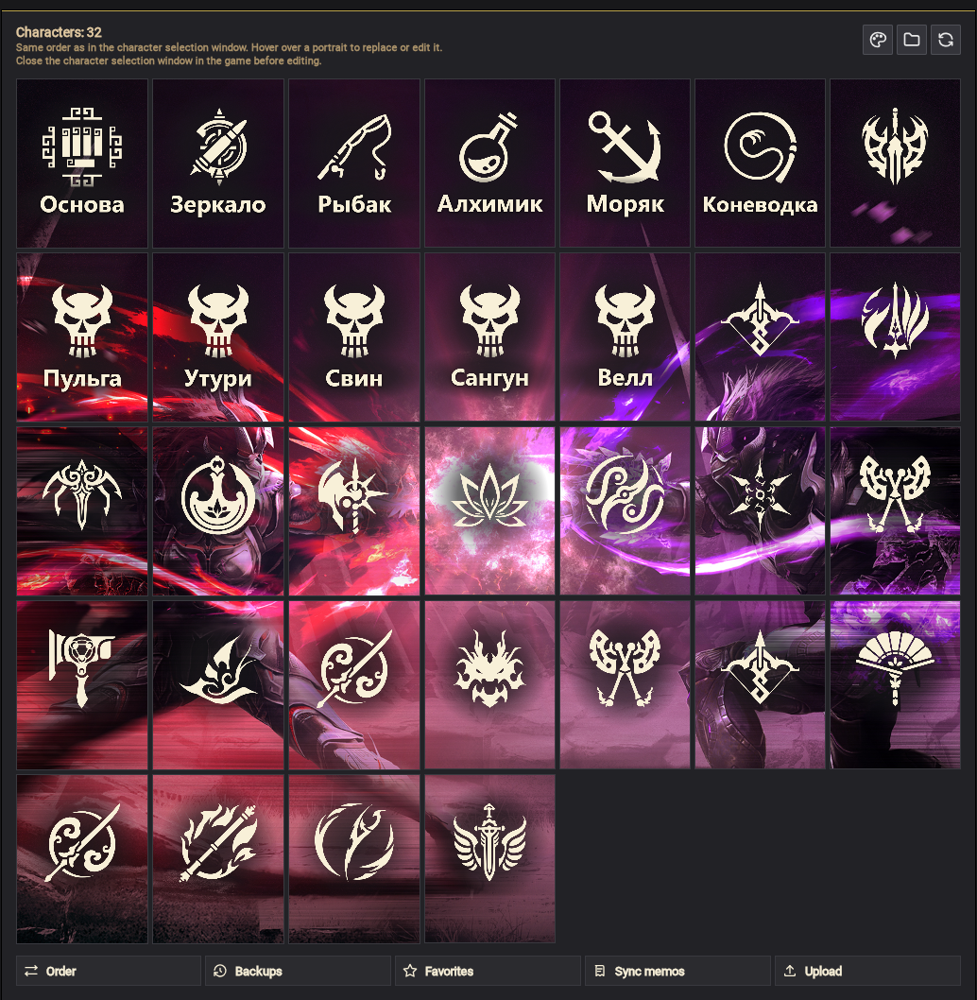
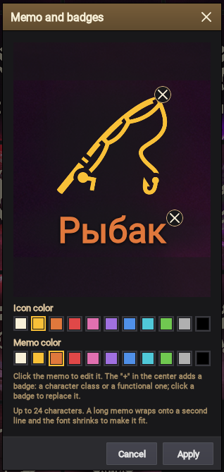

[← BDO Tools](../README.en.md) · [Русский](portraitConstructor.md) · **English**

# Portrait Constructor

Your own images instead of the portraits in the character selection window.

**Images**

- A grid of portraits in the same order as in the character selection window.
- Load an image from your computer (PNG, JPG, WEBP, BMP, GIF), from the clipboard or by link — for one portrait
  or for all at once.
- Frame editor: drag the image and zoom with the mouse wheel (10 to 400%).

**Memos and badges**

- A memo on the portrait — up to 24 characters.
- A character class badge or a functional badge (world boss, professions). The badge list has search at the top —
  just start typing; left click sets the badge, right click sets the badge and puts its name in the memo.
- Icon, memo and shade colors — for one portrait in its "Memo and badges" window, for all at once with the "Memo, badge and shade colors of all portraits" icon next to the title.

  

- "Sync memos" — memos from the portraits go to the character memos in the "Account Character Overview" window.

**Order and sets**

- "Order" — swaps portraits two at a time until you turn the mode off with "Cancel" or Esc.
  Memos and badges stay in place.
- "Favorites" — saves all portraits as a set and brings it back in one click.
- Backups — a portrait can be restored to what it was before a replacement.
