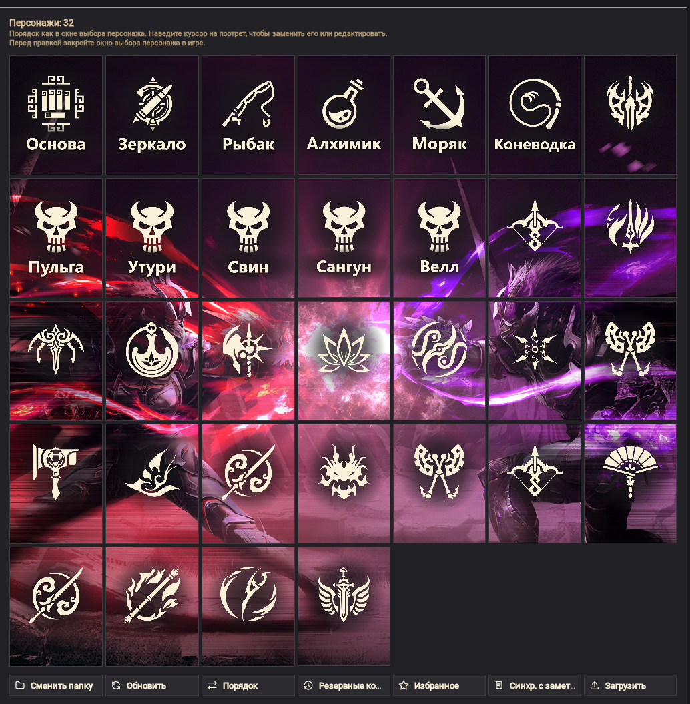
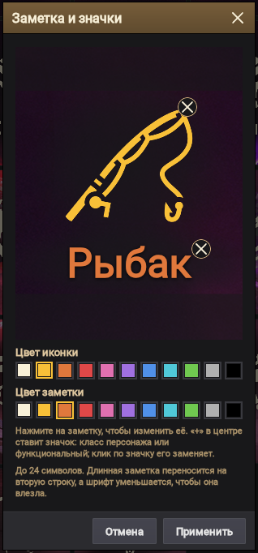

[← BDO Tools](../README.md) · **Русский** · [English](portraitConstructor.en.md)

# Конструктор портретов

Свои картинки вместо портретов в окне выбора персонажа.

**Картинки**

- Сетка портретов в том же порядке, что и в окне выбора персонажа.
- Загрузка картинки с компьютера (PNG, JPG, WEBP, BMP, GIF), из буфера обмена или по ссылке — для одного портрета
  или сразу для всех.
- Редактор кадра: перетаскивание и масштаб колесом мыши (от 10 до 400 %).

**Заметки и значки**

- Заметка на портрете — до 24 символов.
- Значок класса персонажа или функциональный значок (мировой босс, профессии). В списке значков сверху поиск —
  печатать можно сразу; ЛКМ ставит значок, ПКМ — значок и его название в заметку.
- Цвет иконки, заметки и затенения под ними — у одного портрета в его окне «Заметка и значки», у всех сразу — значком «Цвет заметок, значков и затенения
  всех портретов» у заголовка.

  

- «Заметки» — синхронизация: заметки с портретов попадают в заметки персонажей в окне
  «Просмотр персонажей аккаунта».

**Порядок и наборы**

- «Порядок» — меняет портреты местами по два, пока режим не выключен кнопкой «Отменить» или Esc.
  Заметки и значки остаются на прежних местах.
- «Избранное» — сохраняет все портреты набором и возвращает его одним нажатием.
- Резервные копии — портрет можно восстановить до замены.
