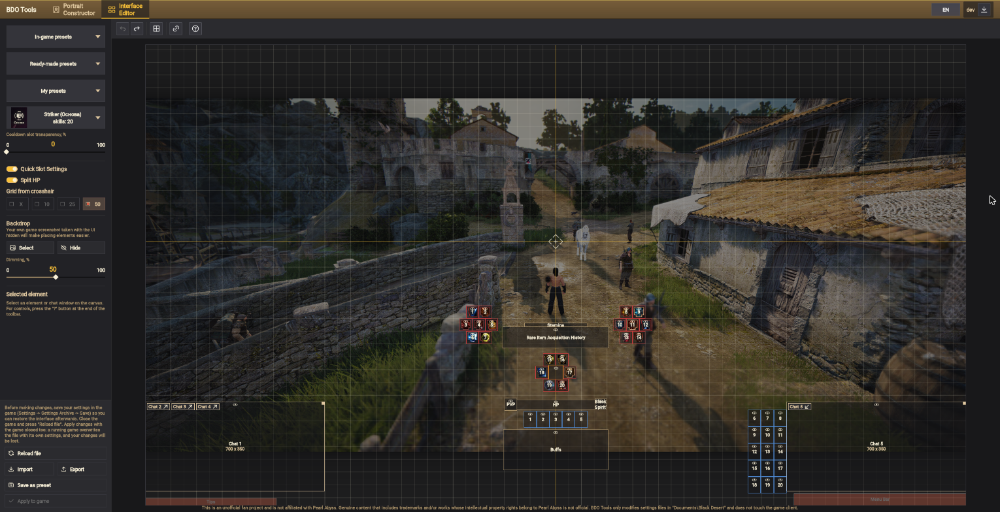
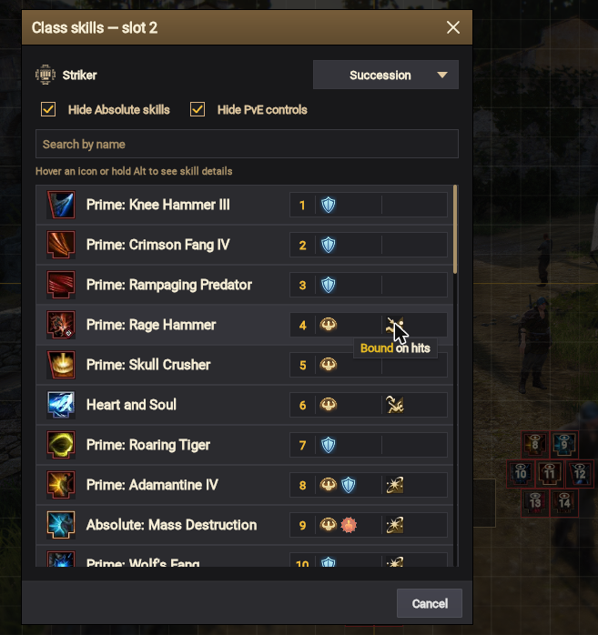
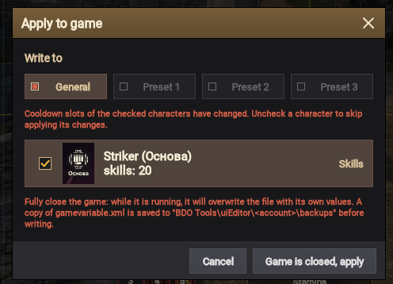

[← BDO Tools](../README.en.md) · [Русский](uiEditor.md) · **English**

# Interface Editor

Lay out cooldown slots and other interface elements on a canvas instead of dragging them around in the game.

## Arranging elements

- Box selection, aligning and distributing elements (the gap slider moves the selection right away), snapping
  to the grid and to each other.
- Canvas zoom — the "Zoom" slider in the toolbar or the mouse wheel (at the cursor); pan the canvas by holding the wheel,
  Space or Shift with the left button.
- The eye on an element hides or shows it; for a selected group — "Hide group" / "Show group" in the right-click
  menu.
- Fixed game elements — tips and the menu bar at the bottom, the health bar at the top left without "Split HP" —
  are filled with translucent red, as in the game's edit mode, so you don't put slots on them.
- Backdrop — your own game screenshot to see how the layout will look in the game, or another player's
  screenshot to place elements like they do. If the screenshot's aspect ratio differs from the game screen, the
  editor warns you.
- Undo and redo — Ctrl+Z and Ctrl+Y (or Ctrl+Shift+Z); "Discard changes" returns the layout from the game file.

## Presets

- **"In-game presets"** — edit the general interface set or presets 1–3 from the game's "Interface Editing" window.
- **"Ready-made presets"** — the layout from the game file and ready-made cooldown slot layouts.
- **"My presets"** — your saved layouts: you can overwrite one with the current layout or delete it, and drag to reorder them.

## Settings as in the game

- **"Quick Slot Settings"** — 20 separate hotbar slots or a single "Quick Slot" panel.
- **"Split HP"** — health, PVP and Black Spirit's Rage separately or a single fixed panel at the top left.
- **Chats** — the main window and separate chat windows on the canvas. They can be moved, resized by the top
  right corner and hidden with the eye. A tab of the main window can be moved to a separate window, and a
  separate window can be moved back with the buttons on the chat bars.

All three settings are carried over by import and export and written to the game together with the layout.

## Skills and labels in slots

Pick a character in the "Choose a character" list (with the portrait from `FaceTexture`) — the cooldown slots
show their skills and labels. The character's class is determined by their skills.

- **Add a skill** — double-click a cooldown slot or right-click → "Add skill". "Replace skill" and
  "Remove skill" are there too.
- **Skill picker**:
  - the title shows the number of the slot you are picking for;
  - top-rank skills of the class with the "Succession" or "Awakening" stance (Ascension classes have no stances)
    and search by name;
  - skills already in slots come first (the slot number is to the left of the icon), then the rest alphabetically;
  - on the right of each skill there is a bar: protection effects (Super Armor, Invincible, Forward Guard) |
    crowd controls. Hovering an icon shows its line from the skill description;
  - click a skill to put it in the slot;
  - "Hide Absolute skills" — for Succession, if the class has Prime skills;
  - "Hide PvE controls" (on) — keeps only the crowd controls that work in PvP.

  

- **One skill — one slot.** A skill picked from another slot moves together with its label.
  Shift+drag swaps the skills of two slots.
- **Skill hover tooltip** — the name, protection effects and PvP crowd controls; with Alt held — the description
  as in the game, in framed blocks (description, requirements and cooldown, command with the character's keys,
  effects).
- **Labels under slots** — up to the game's character limit. Right-click → "Label" adds, edits or deletes a
  skill's label. Below, under "Fill from skill description", is the first key combination from the skill's
  "Command" block (the green one, with the character's keys, e.g. "Shift + Q"): click it to put it in the label.
- **"Cooldown slot transparency"** — fades the frame of slots with skills so the icons look as in the game.

Portraits and captions from the "Portrait Constructor" are re-read every time you open the page.

> [!NOTE]
> The skill database and icons come from the open data of [bdolytics.com](https://bdolytics.com), so an internet
> connection is needed. Without it skills are shown as numbers only; the Windows program shows them from the copy
> saved on its previous run.

## Import and export

The "Import", "Export" and "Save as preset" buttons are at the bottom of the left menu.

- **Export** — share your layout with other players: as a file or with "Copy as text" — a line for chat (Discord).
- **Import** — apply another player's layout: from a file or by pasting the text.
- **Preview** before import and export — choose which elements go into the layout.
  - "Skills in slots" and "Labels under slots" carry over cooldown slot skills and their labels.
  - When importing skills, characters of their class or with empty slots get checked: the first one is selected in
    the editor, and "Apply to game" writes the skills to every checked character.
  - Only the chats that the player already has are changed.

## Applying to the game

"Apply to game" writes the layout to `gamevariable.xml` and saves a backup. The button shows how many changes are
not written yet.

- You can choose where to write, several at once: the general set and "Preset 1–3".
- If skills or labels in slots changed, the window shows which characters change and what exactly.
  Uncheck a character to leave their file as it is.
- The Windows program detects a running game and won't write until you close it.
- **"Undo apply"** — restores the game files to how they were before the last apply (while the page stays open);
  the layout stays in the editor.
