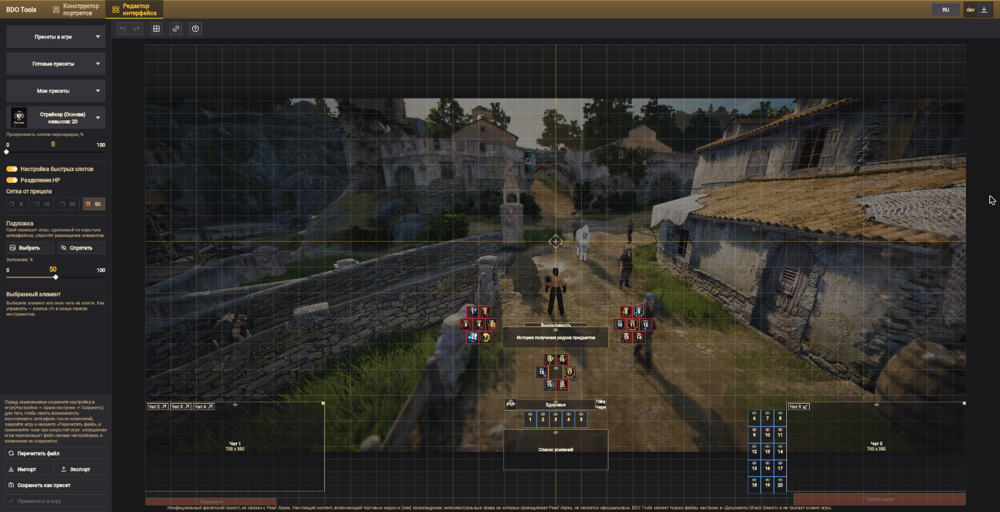
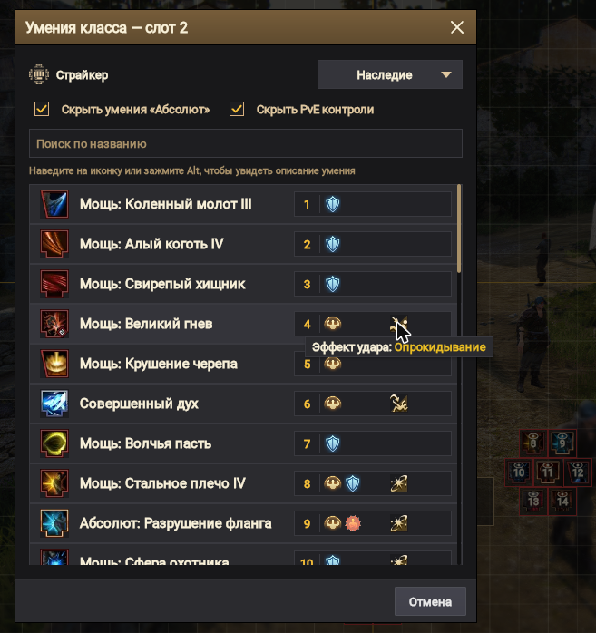
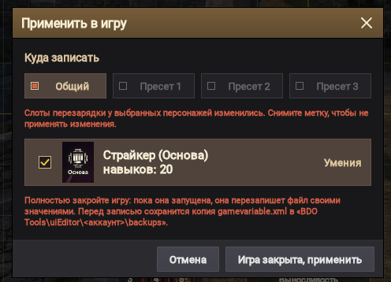

[← BDO Tools](../README.md) · **Русский** · [English](uiEditor.en.md)

# Редактор интерфейса

Раскладка слотов перезарядки и других элементов интерфейса на холсте вместо перетаскивания их в игре.

## Расстановка элементов

- Выделение рамкой, выравнивание и распределение элементов (ползунок промежутка сразу двигает выбранное),
  привязка к сетке и друг к другу.
- Глазик на элементе скрывает или показывает его; у выбранной группы — «Скрыть группу» / «Показать группу»
  в меню правого клика.
- Неподвижные элементы игры — подсказки и панель меню внизу экрана, панель здоровья слева вверху без
  «Разделения HP» — залиты прозрачно-красным, как в режиме правки игры, чтобы не ставить на них слоты.
- Подложка — свой скриншот из игры, чтобы видеть, как раскладка будет выглядеть в игре, или скриншот другого
  игрока, чтобы расположить элементы как у него. Если соотношение сторон скриншота не как у экрана игры, редактор
  предупредит.
- Отменить и повторить — Ctrl+Z и Ctrl+Y (или Ctrl+Shift+Z); «Сбросить изменения» возвращает раскладку из файла игры.

## Пресеты

- **«Пресеты в игре»** — правка общего набора интерфейса или пресетов 1–3 из окна «Редактирование интерфейса».
- **«Готовые пресеты»** — раскладка из файла игры и готовые раскладки слотов перезарядки.
- **«Мои пресеты»** — свои сохранённые раскладки: их можно заменить текущей раскладкой или удалить, а порядок меняется перетаскиванием.

## Настройки как в игре

- **«Настройка быстрых слотов»** — 20 отдельных слотов хотбара или одна панель «Быстрый слот».
- **«Разделение HP»** — здоровье, PVP и гнев Черного духа отдельно или одна неподвижная панель слева вверху.
- **Чаты** — главное окно и отдельные окна чата на холсте. Их можно двигать, растягивать за правый верхний угол
  и скрывать глазиком. Вкладку главного окна можно вынести в отдельное окно, а отдельное окно — внести обратно
  кнопками на плашках чатов.

Все три настройки переносятся импортом и экспортом и записываются в игру вместе с раскладкой.

## Умения и заметки в слотах

Выберите персонажа в списке «Выбрать персонажа» (с портретом из `FaceTexture`) — в слотах перезарядки появятся
его умения и их заметки. Класс персонажа определяется по его умениям.

- **Добавить умение** — двойной клик по слоту перезарядки или правый клик → «Добавить умение». Там же
  «Заменить умение» и «Убрать умение».
- **Окно выбора умений**:
  - в заголовке — номер слота, для которого выбирают;
  - умения последнего ранга класса со стойкой «Наследие» или «Пробуждение» (у классов «Освобождения» стоек нет)
    и поиск по названию;
  - сначала умения, которые уже стоят в слотах (номер слота — слева у иконки), потом остальные по алфавиту;
  - справа у каждого умения плашка: эффекты защиты (устойчивость, невредимость, защита от атак спереди) |
    контроли. При наведении на значок — его строка из описания умения;
  - клик по умению ставит его в слот;
  - «Скрыть умения «Абсолют»» — у наследия, если у класса есть «Мощь»;
  - «Скрыть PvE контроли» (включено) — оставляет только контроли, которые действуют в PvP.

  

- **Одно умение — один слот.** Умение, выбранное из другого слота, переезжает вместе с заметкой.
  Shift+перетаскивание меняет умения слотов местами.
- **Подсказка при наведении на умение** — название, эффекты защиты и PvP-контроли; с зажатым Alt — описание как
  в игре, блоками в рамке (описание, требования и перезарядка, команда с клавишами персонажа, эффекты).
- **Заметки под слотами** — до лимита символов игры. Правый клик → «Заметка» добавляет, редактирует или удаляет
  заметку умения. Ниже, под «Заполнить из описания умения», — первая связка клавиш из блока «Команда»
  (выделенная зелёным, с клавишами персонажа, например «Shift + Q»): клик ставит её в заметку.
- **«Прозрачность слотов перезарядки»** — приглушает рамку слотов с умениями, чтобы иконки выглядели как в игре.

Портреты и подписи из «Конструктора портретов» перечитываются при каждом открытии страницы.

> [!NOTE]
> Справочник умений и иконки берутся из открытых данных [bdolytics.com](https://bdolytics.com), поэтому нужен
> интернет. Без него умения видны только номерами; программа для Windows показывает их из копии, сохранённой
> при прошлом запуске.

## Импорт и экспорт

Кнопки «Импорт», «Экспорт» и «Сохранить как пресет» — внизу меню слева.

- **Экспорт** — поделиться своей раскладкой с другими игроками: файлом или «Копировать текстом» — строкой
  для чата (Discord).
- **Импорт** — применить раскладку другого игрока: из файла или вставив текст.
- **Превью** перед импортом и экспортом — выбрать, какие элементы войдут в раскладку.
  - «Умения в слотах» и «Заметки под слотами» переносят умения слотов перезарядки и их заметки.
  - При импорте умений отмечаются персонажи их класса или с пустыми слотами: первый выберется в редакторе,
    а «Применить в игру» запишет умения всем отмеченным.
  - Чаты у игрока меняются только те, что есть у него самого.

## Применение в игру

«Применить в игру» записывает раскладку в `gamevariable.xml` и сохраняет резервную копию. На кнопке — сколько
изменений ещё не записано.

- Можно выбрать, куда записать, — сразу в несколько: общий набор и «Пресет 1–3».
- Если изменились умения или заметки в слотах, окно показывает, у каких персонажей и что именно изменится.
  С персонажа можно снять отметку — его файл останется как был.
- Программа для Windows видит запущенную игру и не пишет, пока её не закроют.
- **«Откатить применение»** — возвращает файлы игры к состоянию до последнего применения (пока страница
  не закрыта); раскладка в редакторе остаётся.
